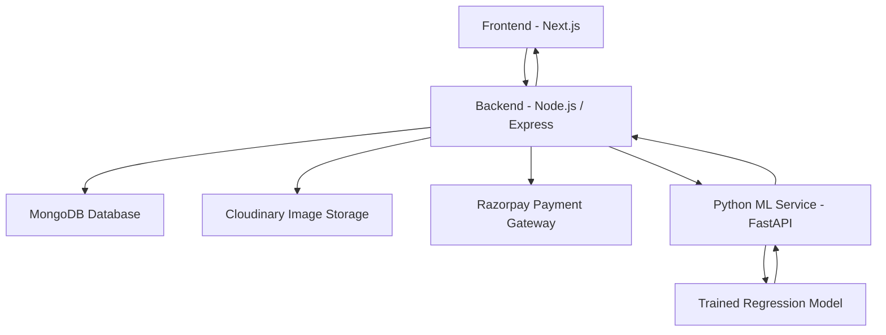

# ReTag: An ML-Powered Intelligent Thrift Marketplace

## 1. Introduction
ReTag is a full-stack thrift commerce platform built for second-hand fashion resale. The system combines user authentication, seller-side item submission, image upload, machine-learning-based price prediction, admin approval, product listing, cart management, wishlist support, and payment integration in a single marketplace. The primary goal of the project is to create a trustworthy and intelligent resale platform that can generate fair, data-driven price suggestions while maintaining transparent human review before final listing.

## 2. Problem Statement
Second-hand clothing marketplaces face several practical challenges such as pricing inconsistency, uncertainty about product condition, lack of standardized listing workflows, and heavy dependence on manual review. Sellers often do not know the fair resale value of their items, while buyers hesitate because quality and pricing are difficult to trust. Fixed rules alone are not sufficient to model the complex relationship between brand, category, wear level, condition, and description quality. To solve this problem, ReTag is designed as an ML-powered thrift marketplace in which a trained regression model predicts resale price from structured product attributes and image-derived condition signals.

## 3. Objective of the Proposed ML-Based System
The primary objective of ReTag is to build a complete intelligent thrift marketplace in which resale pricing is assisted by a trained Machine Learning model. The proposed system aims to:
- predict fair resale price using product attributes and image-derived condition features,
- improve pricing consistency and reduce manual estimation effort,
- support scalable price prediction for newly submitted items,
- provide a full seller-to-admin-to-buyer workflow within one platform,
- combine full-stack web development with applied Machine Learning in a practical academic project.

## 4. Dataset Used
The Machine Learning model is trained using the **Mercari Price Suggestion Dataset** available on Kaggle. This dataset is widely used for resale-price prediction tasks and contains large-scale product listing records.

### 4.1 Selected Features
The following attributes are used for model development because they closely match the attributes already collected in ReTag:
- **Brand name**
- **Category name**
- **Item condition**
- **Item description**
- **Price** (target variable)

These fields are suitable for supervised regression because they directly influence perceived market value in resale commerce platforms.

## 5. Machine Learning Pipeline
The new pricing engine follows a standard supervised learning workflow.

### 5.1 Data Preprocessing
The dataset is first cleaned and transformed before training. The following preprocessing operations are performed:
- handling missing values in brand, category, and description fields,
- removal of invalid or zero-price records,
- normalization of text fields,
- categorical encoding for brand and category,
- train-test split for unbiased model evaluation.

### 5.2 Feature Engineering
Feature engineering improves model performance by converting raw fields into informative inputs. The following techniques are applied:
- label encoding or one-hot encoding for categorical variables,
- TF-IDF vectorization for textual description,
- extraction of description length and keyword intensity,
- transformation of condition into ordinal numeric form.

### 5.3 Model Training
Two regression algorithms are considered for price prediction:
- **Linear Regression** for baseline modelling and interpretability,
- **Random Forest Regressor** for capturing non-linear relationships among features.

After experimentation, Random Forest is preferred for deployment because resale pricing depends on complex interactions between category, condition, brand value, and description quality.

### 5.4 Model Evaluation
The trained models are evaluated using standard regression metrics:
- **MAE (Mean Absolute Error):** measures average prediction deviation from actual price,
- **R² Score:** measures how well the model explains price variance.

A lower MAE and higher R² indicate better model quality. These evaluation metrics are included in the report to justify model selection.

## 6. ML Module Design
The price prediction module is implemented as an independent Python microservice using **FastAPI**. This service loads the serialized trained model and preprocessing objects, accepts structured product input from the backend, performs preprocessing, and returns the predicted price as a JSON response.

### 6.1 Why FastAPI
FastAPI is selected because it is lightweight, fast, easy to integrate with Python ML libraries, and suitable for REST-based model serving. It also enables simple deployment of inference endpoints for real-time prediction.

## 7. System Workflow and Service Interaction
ReTag follows a service-oriented architecture in which the Node.js backend acts as the main application layer and communicates with a dedicated Python ML microservice for price prediction.

### 7.1 Core Pricing Flow
Frontend → Node.js backend → Python ML API → predicted price → Node.js backend → frontend

In this workflow:
- the frontend collects product details through the seller flow,
- the Node.js backend handles authentication, validation, file upload, business rules, and database persistence,
- the Python ML API receives structured pricing features and returns a model-based prediction,
- the predicted price is stored in the product analysis object and shown to both seller and admin.

## 8. System Architecture
The overall application architecture is designed as a full-stack modular marketplace with a dedicated ML service layer for pricing inference.

### 8.1 Architectural Interpretation
- **Frontend Layer:** handles user interaction, sell form, cart, checkout, and dashboard views.
- **Backend Layer:** manages routing, authentication, validation, admin control, and API orchestration.
- **ML Service Layer:** performs price inference using the trained model.
- **Database Layer:** stores users, products, orders, and prediction results.

## 9. Implementation Details
The implementation of ReTag is divided into four major phases.

### 9.1 Full-Stack Marketplace Development Phase
- Design seller, buyer, and admin workflows.
- Implement frontend screens for product browsing, selling, cart, wishlist, checkout, and admin management.
- Develop backend APIs for authentication, product submission, order handling, payment support, and admin actions.

### 9.2 Model Development Phase
- Prepare resale-oriented training data from Mercari-style and ReTag-style records.
- Perform preprocessing and feature engineering in Python using Scikit-learn.
- Train Linear Regression and Random Forest models.
- Evaluate models using MAE and R².
- Serialize the selected model using `joblib`.

### 9.3 ML Service Deployment Phase
- Build a FastAPI endpoint such as `/predict`.
- Load the trained model artifact and metadata at service startup.
- Accept request payload containing product metadata and image-derived condition features.
- Return predicted price, confidence estimate, and expected range in JSON format.

### 9.4 Seller and Admin Experience Phase
- Show the ML-based pricing result on the seller analysis screen.
- Display source, confidence, and model version on the admin dashboard.
- Allow admin approval before the product is finally listed in the marketplace.

## 10. Tools and Technologies
### Frontend
- Next.js 15
- TypeScript
- Tailwind CSS
- React Context API

### Backend
- Node.js
- Express.js
- MongoDB with Mongoose
- Passport.js and JWT

### Machine Learning
- Python
- Pandas
- NumPy
- Scikit-learn
- FastAPI
- Joblib

### External Services
- Cloudinary
- Razorpay
- Google-based image analysis support (for visual feature extraction, where applicable)

## 11. Advantages of the ML-Based Approach
The proposed ML-powered ReTag platform offers the following benefits:
- improved consistency in price estimation,
- data-driven predictions based on learned market patterns,
- easier future retraining with newer data,
- better academic relevance as a Machine Learning-integrated software system,
- clear separation between application logic and prediction logic,
- stronger trust through admin review and transparent pricing metadata.

## 12. Future Scope
The ML-enhanced ReTag system can be extended further in the following directions:
- training on a more localized **Indian resale dataset** for improved regional accuracy,
- experimenting with advanced models such as XGBoost or neural networks,
- adding image-based feature extraction for visual quality-aware pricing,
- enabling periodic retraining with live marketplace data,
- introducing explainable AI to show why a predicted price was generated,
- combining text, metadata, and image embeddings for multimodal pricing.

## 13. Conclusion
ReTag is presented as an ML-powered intelligent thrift marketplace that combines full-stack web development with applied Machine Learning for resale valuation. The system uses a trained regression model served through a Python FastAPI microservice to generate data-driven price suggestions from product metadata and image-derived condition signals. Along with seller workflows, admin review, marketplace listing, and payment support, the project demonstrates a practical integration of frontend engineering, backend services, cloud-based media handling, and ML inference. This makes ReTag a strong B.Tech minor project that showcases both software system design and real-world Machine Learning application.
